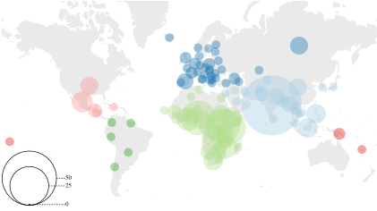

# LIMIT: Language Identification, Misidentification, and Translation

 

# Paper
https://aclanthology.org/2023.emnlp-main.895/

# Note
We are currently auditing the dataset for the following
1. Manually inspecting and sharing the dataset on HuggingFace so researchers can use it for their experiements.
2. Updating the repository with easy-to-run code to reproduce our experiments
3. Modularizing and generalizing our experiment code, so researchers can use our proposed confusion-based hierarchical approach for their datasets.


# Cite this project
Please consider citing our paper if you use the data, benchmarking results, or the (mis)identification hierarchical modeling approach
```
@inproceedings{agarwal-etal-2023-limit,
    title = "{LIMIT}: Language Identification, Misidentification, and Translation using Hierarchical Models in 350+ Languages",
    author = "Agarwal, Milind  and
      Alam, Md Mahfuz Ibn  and
      Anastasopoulos, Antonios",
    editor = "Bouamor, Houda  and
      Pino, Juan  and
      Bali, Kalika",
    booktitle = "Proceedings of the 2023 Conference on Empirical Methods in Natural Language Processing",
    month = dec,
    year = "2023",
    address = "Singapore",
    publisher = "Association for Computational Linguistics",
    url = "https://aclanthology.org/2023.emnlp-main.895",
    doi = "10.18653/v1/2023.emnlp-main.895",
    pages = "14496--14519",
    abstract = "Knowing the language of an input text/audio is a necessary first step for using almost every NLP tool such as taggers, parsers, or translation systems. Language identification is a well-studied problem, sometimes even considered solved; in reality, due to lack of data and computational challenges, current systems cannot accurately identify most of the world{'}s 7000 languages. To tackle this bottleneck, we first compile a corpus, MCS-350, of 50K multilingual and parallel children{'}s stories in 350+ languages. MCS-350 can serve as a benchmark for language identification of short texts and for 1400+ new translation directions in low-resource Indian and African languages. Second, we propose a novel misprediction-resolution hierarchical model, LIMIT, for language identification that reduces error by 55{\%} (from 0.71 to 0.32) on our compiled children{'}s stories dataset and by 40{\%} (from 0.23 to 0.14) on the FLORES-200 benchmark. Our method can expand language identification coverage into low-resource languages by relying solely on systemic misprediction patterns, bypassing the need to retrain large models from scratch.",
}
```

